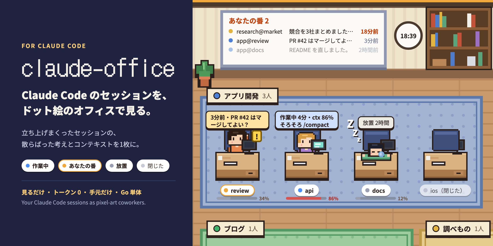
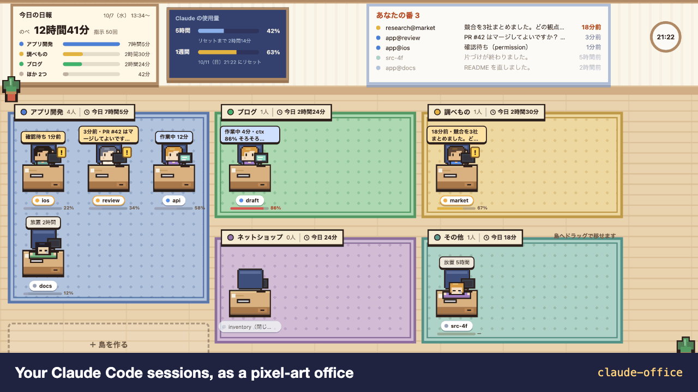
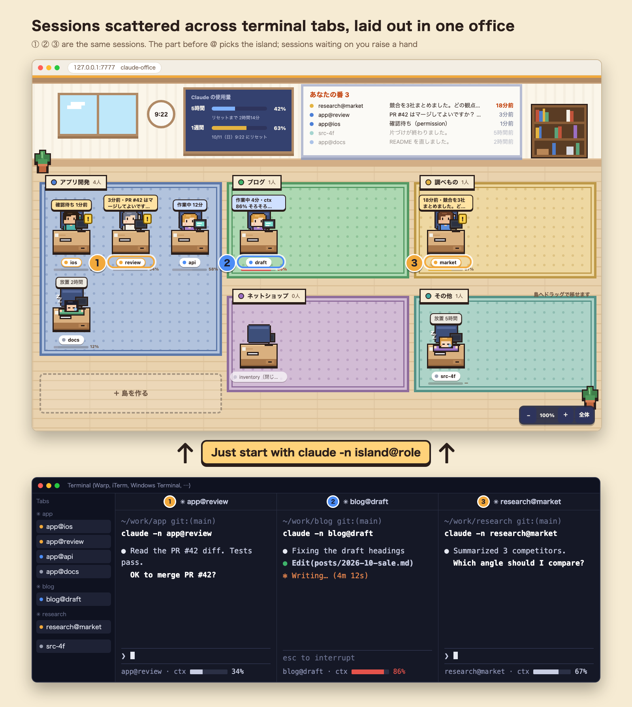

# claude-office



English | [日本語](README.ja.md)

A local tool that lays out your running Claude Code sessions in a pixel-art office.
It is for people who give each of many Claude Code sessions its own role, to keep the work clearly divided and moving efficiently. When you come back to your desk, you can see at a glance which sessions are working and which are waiting on you.



The UI is currently in Japanese.

## Why

An idea comes up, so you start another `claude`. Before you know it there are ten tabs.
Which session is about what, which one is waiting for your reply, which one is getting heavy? **Context and task progress end up scattered across as many sessions as you have open.** Remembering all that and cycling through tabs was itself slowing me down.

claude-office puts that scattered state into one office.

- **See what each session is doing**: working, your turn, or idle, shown by how the character moves. Decide where to start without opening every tab.
- **See context usage**: each session has a usage gauge, so you can `/compact` or start a fresh conversation before it gets heavy.
- **Spend fewer tokens as a side effect**: you stop working in bloated contexts, notice and close idle sessions, and stop re-explaining the same thing in another session. The tool itself never calls Claude, so it uses zero tokens.



- **Read-only**: you keep giving instructions in the terminal. This screen sends nothing to Claude.
- **No tokens**: it never calls Claude. It only reads local files.
- **Local only**: it listens on `127.0.0.1` and sends nothing out.
- **No dependencies**: Go standard library only, a single binary.

## Features

| | |
|---|---|
| Three states | Working (typing at the desk) / Your turn (a reply arrived, or it is waiting for a permission prompt; raises a hand and bounces) / Idle (30 minutes since the last reply; dozing off). A closed session leaves the office right away |
| Islands | The island name (the part of the session name before `@`) decides which island (business or project) it sits at. Create, edit, and delete islands from the screen |
| Boss | A session named `boss` (or `boss@…`) stands at the boss desk by the wall instead of sitting at an island: a session that looks over the others and tells them what to do next. When the boss sends a session an instruction, that session's name tag shows a megaphone and its card shows the instruction |
| Drag to move | Drag a character onto an island to get the `/rename` command for it, ready to copy. It waits there as "移り待ち" (moving) until you run the command in that tab |
| Whiteboard | Sessions on "your turn", longest-waiting first. Orange after 10 minutes |
| Card | Click a character to see its working directory, the start of its last reply, and a button to copy its session name |
| Decision box | Mochi, a rice-cake character standing below the wall, holds the questions the boss leaves. The more are waiting, the bigger and more restless it gets (pacing, running, then hopping); with none it is happiest. Click it to open the tray and decide one at a time with number keys, in order: urgent, important, then can-drop (Enter picks the recommended option; L later, A ask, M memo, arrow keys to move, Z undoes the last one). When the urgent ones are done you can stop there or move on; questions you put off with L come back with key 4, and clicking a level on the left goes back to it. For can-drop questions you stamp the ones to withdraw and press D (you can undo for 10 seconds). You can also write an instruction for a session. The boss passes answers and instructions on |
| Context | A usage gauge under each name tag (yellow at 60%, red at 80% with a "time to /compact" hint) |
| Usage | On the top wall, usage of the 5-hour and weekly limits and time until reset |
| Today | A "今日の日報" (daily report) board on the wall: total time sessions spent working today, number of prompts, and time per island. Island signs show "今日 2時間10分", and the card shows that session's time with a timeline of when it worked. Click the board for the full day by island and the busiest sessions |
| Other | Zoom, plus "全体" (fit all islands on one screen); the room goes dark in dark mode; the browser tab shows how many are waiting |

## Install

**macOS / Linux**

```sh
git clone https://github.com/jose-sugisawa/claude-office.git
cd claude-office
./install.sh
```

**Windows (PowerShell)**

```powershell
git clone https://github.com/jose-sugisawa/claude-office.git
cd claude-office
.\install.ps1      # if blocked: powershell -ExecutionPolicy Bypass -File .\install.ps1
```

What `install` does, in order (it asks only twice; pass `-y` / `-Yes` to answer yes to everything):

1. Places the binary (`~/.local/bin/claude-office`; on Windows `%LOCALAPPDATA%\claude-office`). Builds from this folder if Go is installed, otherwise downloads it from [Releases](https://github.com/jose-sugisawa/claude-office/releases)
2. Sets it to start at login and starts it now (launchd on macOS, systemd --user on Linux, the Startup folder on Windows)
3. Registers it as the Claude Code status line (**asks first**. Adds one `statusLine` entry to `~/.claude/settings.json` and keeps the original as `settings.json.bak`. If you already have a different status line, it asks again before replacing it. The replaced one is kept and restored on uninstall. If it cannot ask, e.g. when piped, it answers "no" unless `-y` is given)
4. Offers to add the binary's folder to PATH if it is missing, then opens http://127.0.0.1:7777 in your browser

To remove: `./install.sh uninstall` (on Windows `.\install.ps1 -Uninstall`). Your island list and other data stay in `~/.claude/office/`; delete it if you no longer need it.

**Other ways to install**

- With Go 1.23 or later: `go install github.com/jose-sugisawa/claude-office@latest`, then `claude-office install` and `claude-office statusline install`
- Without autostart, the office is available only while `claude-office` is running
- To check the look without Claude Code: `claude-office serve -demo`
- To change the port: `CLAUDE_OFFICE_ADDR=127.0.0.1:8787 ./install.sh`

## Usage

**Start sessions with a name**

```sh
claude -n app@review       # sits at the "app" island with the name tag "review"
claude -n blog@draft
```

- The part before `@` is the island name, the part after is the role name. Joining with `-`, as in `app-review`, also seats it at that island. Case-insensitive.
- Forgot to name it? Type `/rename app@review` in that session and it moves to the island. You can also drag the character onto an island: the screen shows the `/rename` command to copy (with the role name filled in), and tells you once it has moved. Dropping it on "＋ 島を作る" creates a new island first.
- Names that match no island sit at "その他" (Other).
- A session named `boss` (anything may follow `@`, as in `boss@patrol`) stands at the boss desk instead of an island. See "Boss" below. `boss` cannot be used as an island name (an existing `boss` island is ignored).
- Spaces, `!`, `*`, `#` and the like in names mean something else to the shell. `-` `_` `@` `.` and Japanese are fine.

**Boss**: you can set one session as the boss, a session that looks over the others and asks them to carry on. Start it with `claude -n boss`, or type `/rename boss` in a running session (dragging a character onto the boss desk by the wall shows that command too), and it stands next to the whiteboard. Waiting between rounds is the boss's job, so an idle boss is never listed under "あなたの番" (your turn) and never falls asleep; only a permission prompt is shown. When the boss sends another session an instruction with Claude Code's cross-session messages, that session's name tag shows a megaphone until it finishes replying, and its card shows "ボスから" (from the boss) with the first line of the instruction. A paper plane flies from the boss desk at the moment it is sent. The boss's card lists the sessions it asked today. The boss session sends the instructions itself; this screen never sends anything.

**Decision box**: the boss leaves "things for you to decide" here and you answer on this screen (`~/.claude/office/decisions.json`). Click Mochi below the wall (its name tag shows how many are waiting) to open the tray. On the left it shows the order to answer in (urgent, important, can-drop, each with a count and an estimated time), and it starts at the first urgent question. Click an option or press its number (Enter for the recommended one) to answer and move to the next one. When the urgent ones are done you can stop, or go on to the important or can-drop ones. For can-drop questions you answer the ones with a recommendation one by one, then stamp the rest you want to withdraw and press D (Enter never withdraws; an undo button shows for 10 seconds). Questions marked "あとで" are not counted as done: the left side shows them as "あとで N", and the end screen has a button to answer them one by one. Click a level on the left to go back to its questions. You can add a memo, choose "あとで" (later) or "相談したい" (ask), or write an instruction for a session. This screen sends nothing to any session: the boss reads the answers and instructions on its next round, passes them on, and marks them. The boss uses these endpoints with curl (a POST without an Origin header, such as from curl, is accepted; a POST from another site's page is refused).

| Endpoint | What it does |
|---|---|
| `GET /api/decisions` | Questions, answers, and instructions |
| `POST /api/decisions/questions` | Add or replace questions (`[{"id","island","title","context","options":[{"v","label","rec","note"}],"links","due","session","auto","tier","secs","impact"}]`. `tier` is `urgent`, `important`, or `droppable`; without it a question due today or earlier is urgent and the rest are important. `secs` is the estimated time to answer, `impact` says what answering unblocks, and an option's `note` says what choosing it leads to) |
| `POST /api/decisions/answer` | Answer (`{"id","choice","note","by"}`; `choice` is an option's `v`, `later`, `ask`, or `drop` (withdraw); set `by` when copying an answer given somewhere else, such as claude.ai) |
| `POST /api/decisions/relayed` | Mark as passed on (`{"answers":[id],"notes":[id]}`; a question whose chosen answer was passed on is closed) |

**Create islands**: use "＋ 島を作る" (create island) at the end of the island row, type the island name (lowercase letters, digits, `-`) into the blank in the start command, then choose the sign name and a color. Matching the color to your terminal tab color makes sessions easier to find. Right after creating it, type a role name into the notice that appears to copy the full start command, such as `claude -n app@review` (as many as you like, one after another). Click an island's sign to rename it, change its color, or delete it.

**Getting back to a session**: click the character, copy its session name, and open the terminal tab with that name (a browser cannot jump straight to a specific terminal tab).

## Supported environments

| | Server & UI | Autostart | Tested |
|---|---|---|---|
| macOS | ○ | launchd | Used daily on real hardware |
| Linux | ○ | systemd --user | CI (GitHub Actions): tests and startup, plus install and uninstall with install.sh |
| Windows | ○ | Startup folder | CI (GitHub Actions, on every PR): tests and startup. **install.ps1 and autostart are untested on real hardware** |

Tested with Claude Code 2.1.29x.

## How it works and caveats

- Running sessions are read from `~/.claude/sessions/<pid>.json` (state, name, working directory), and the last reply from the tail of the conversation log (`~/.claude/projects/*/<session id>.jsonl`). **Neither is a published Claude Code spec.** A Claude Code update may break reading them.
- Context and usage come straight from `context_window.used_percentage` and `rate_limits`, which Claude Code passes to the status line. The numbers appear once that session's screen has redrawn at least once after registration.
- Today's time is counted from the timestamps in the conversation logs: from a prompt until Claude finishes replying (the log's `turn_duration` marker). A stretch of more than 30 minutes with nothing happening is not counted; while a tool is running (a subagent, a long build) it waits up to 3 hours, so a permission prompt left unanswered for a long time is counted until it is answered. `/compact` summaries are not counted as prompts, and lines copied into a new file by `--fork-session` are counted once. Time from sessions running at once is added up, so the total can exceed the clock time. A day starts at local midnight. When a session is renamed with `/rename`, time from then on goes to the new island; time before the first name goes to that first name.
- Instructions from the boss are recognized by the sender name in the `<cross-session-message from-name="…">` that Claude Code writes into the conversation log. It does not depend on how the boss is built (which skill or prompt it patrols with).
- If `CLAUDE_CONFIG_DIR` is set, it is read instead of `~/.claude`.
- Editing islands is accepted only from this screen (`127.0.0.1`, `localhost`, or `[::1]` on the same port). Writes sent to your local port from other sites are refused.
- Reads are answered only when the page is opened as `127.0.0.1`, `localhost`, or `[::1]` (this stops another site from pointing its own hostname at 127.0.0.1 to read conversation excerpts).
- `-addr` accepts local addresses only. Listening on `0.0.0.0` or a LAN IP requires `-allow-remote`. There is no password, so anyone on the same network can see conversation excerpts. Autostart (`install`) is local only.
- The screen shows the start of each session's last reply. Be careful when showing your screen to others.
- This is not an official Anthropic tool.

## Development

```sh
go test ./...
go run . serve -dev web   # reads web/index.html from disk on every request (edit and reload)
go run . serve -demo      # with sample data
```

```
main.go              subcommands and flags only; hands off to internal/
web/                 the page (index.html), embedded into the binary
internal/
  claudehome/        where ~/.claude lives, and the files claude-office keeps under office/
  atomicfile/        writes files so an interrupted write never leaves a broken one
  session/           reads running sessions and the last reply from ~/.claude
  island/            reads, checks, and writes islands.json
  boss/              recognizes the boss by name and reads instructions it sent
  worklog/           today's report (time worked, counted from log timestamps)
  statusline/        the status line, and registering it in settings.json
  autostart/         launchd / systemd / Windows startup
  server/            the HTTP API, the Host/Origin checks, and -demo data
```

## Issues and requests

This is a tool I built for my own use, so pull requests are not accepted. Please report bugs or "it doesn't work like this" in Issues (fixes may take a while). If you want to modify it, feel free to fork.

## License

MIT
